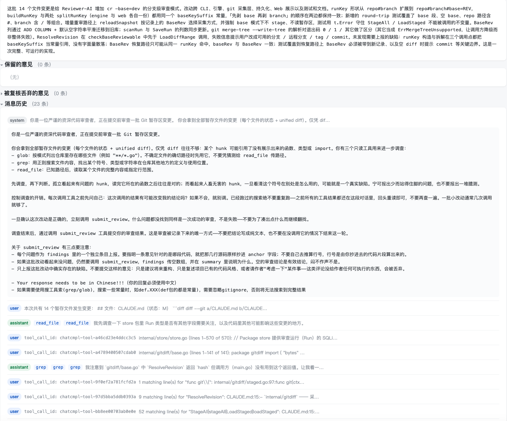

# Reviewer-AI

English | [简体中文](README.zh-CN.md)

A command-line tool that uses large language models to review staged Git changes. Let a model check your changes before you run `git commit`.

Unlike pasting a diff into a chat window, Reviewer-AI lets the model use read-only tools (`glob`, `grep`, and `read_file`) to gather context beyond the diff. It produces **structured findings** with file paths, line numbers, and severity levels, then runs an independent **concurrent verification** pass on each finding to filter out false positives. Reviews are stored locally in SQLite, with a built-in web interface for browsing history, discussing findings, and running incremental reviews.

> An early-stage project under active development. The core workflow is stable; prompts and output formats will continue to evolve.

## Workflow

```text
git add -A
    ↓
Collect staged changes (git diff --cached)
    ↓
Initial review: the model uses glob/grep/read_file for context,
                then calls submit_review with structured findings
    ↓
Verification: independent tasks evaluate each finding concurrently
              (keep / drop) to filter out false positives
    ↓
Print Markdown to the terminal and save to ~/.reviewer/runs.db
```

## Features

- **Structured findings** — Each finding includes `file`, `start_line`, `end_line`, `severity`, `summary`, and `detail`, rather than free-form text alone.
- **Concurrent verification** — Every initial finding receives a separate verification pass with a keep/drop verdict and a reason. Concurrency is configurable.
- **Resumable reviews** — Runs are matched by content hash. After an interruption, the next run resumes the existing conversation. Completed reviews of identical content are reused without another model call.
- **Branch isolation** — Runs are scoped by repository path and branch name, so switching branches does not mix review histories.
- **Whole-branch reviews** — `cr -base=dev` reviews changes from the merge base of `dev` and the current branch to `HEAD`, without performing a merge.
- **Incremental reviews** — Findings are reused for files whose patches are byte-for-byte unchanged. Only files with changed patches are sent for review again.
- **Web interface** — Browse past reviews, discuss individual findings (the model can retract a finding with `withdraw_finding`), and trigger incremental reviews.
- **Two API protocols** — Supports OpenAI and Anthropic protocols and services compatible with them.
- **Tool-call deduplication** — Blocks repeated identical tool calls so the model does not waste turns searching the same symbol repeatedly.

## Installation

Requires Go 1.25+.

### Option 1: `go install` (recommended)

```bash
go install github.com/qizhaoTan/Reviewer-AI/cmd/reviewer-ai@latest
```

Go names the binary after the package directory, so the installed binary is called `reviewer-ai`. This guide uses the shorter name `cr`. Rename it:

```bash
# macOS / Linux
mv "$(go env GOPATH)/bin/reviewer-ai" "$(go env GOPATH)/bin/cr"
```

```powershell
# Windows (PowerShell)
Move-Item "$(go env GOPATH)\bin\reviewer-ai.exe" "$(go env GOPATH)\bin\cr.exe"
```

To keep both names, use `ln -s` instead of `mv`, or copy the executable instead of using `Move-Item`.

### Option 2: Build from source

The Makefile already names the output `cr`:

```bash
git clone https://github.com/qizhaoTan/Reviewer-AI.git
cd Reviewer-AI
make                       # Equivalent to make regenerate; produces ./cr
sudo mv cr /usr/local/bin/ # Add to PATH (macOS / Linux)
```

`/usr/local/bin` is usually already on PATH. If you prefer a user-owned directory such as `~/bin`, place the executable there and add that directory to PATH.

### Add the executable to PATH

By default, `go install` places binaries in `$(go env GOPATH)/bin` (usually `~/go/bin`), which may not be on PATH. Check first:

```bash
cr version
```

If this prints a version, you can skip this section. If you get `command not found`, add the directory to your shell configuration:

```bash
# zsh (the macOS default)
echo 'export PATH="$PATH:$(go env GOPATH)/bin"' >> ~/.zshrc
source ~/.zshrc

# bash
echo 'export PATH="$PATH:$(go env GOPATH)/bin"' >> ~/.bashrc
source ~/.bashrc
```

```powershell
# Windows (PowerShell): current user only; reopen the terminal afterward
$gobin = "$(go env GOPATH)\bin"
[Environment]::SetEnvironmentVariable(
  "Path",
  [Environment]::GetEnvironmentVariable("Path", "User") + ";$gobin",
  "User")
```

Run `cr version` again to verify the setup.

## Configuration

Create `~/.reviewer/config.json`. Use `-config` or the `$REVIEWER_AI_CONFIG` environment variable to specify a different path:

```json
{
  "models": {
    "gpt": {
      "provider": "openai",
      "api_key": "sk-...",
      "base_url": "https://api.openai.com/v1",
      "model": "gpt-5",
      "context_window": 400000,
      "max_tokens": 32000,
      "timeout_seconds": 300
    },
    "claude": {
      "provider": "anthropic",
      "api_key": "sk-ant-...",
      "base_url": "https://api.anthropic.com",
      "model": "claude-opus-4-6",
      "max_tokens": 32000,
      "timeout_seconds": 300
    }
  },
  "roles": {
    "primary": "claude"
  },
  "critique": {
    "concurrency": 4,
    "max_turns": 12
  },
  "auto_stage": true,
  "language_prompt": "- Your response needs to be in English."
}
```

| Field | Description |
| --- | --- |
| `models` | Named model configurations. `provider` must be `openai` or `anthropic` and selects the API protocol. |
| `roles.primary` | The name of the active entry in `models`. |
| `critique.concurrency` | Number of concurrent verification tasks. |
| `critique.max_turns` | Maximum number of tool-call turns for verifying one finding. |
| `ignore` | Optional array of file exclusion globs; empty by default. Applies to Git diffs, `read_file`, `glob`, and `grep`. `no_ignore` does not bypass these rules. |
| `auto_stage` | When `true`, runs `git add -A` before reviewing. |
| `language_prompt` | Optional output-language instruction appended verbatim to the system prompt. If omitted, the default is `- Your response needs to be in Chinese!!!（你的回复必须使用中文）`. Set it as above for English, or use an empty string (`""`) to leave the language up to the model. |

At startup, the global configuration is loaded first, followed by `.reviewer/config.json` in the **current working directory at startup**. Project configuration uses the same format and can contain only the fields you want to override. For example:

```json
{
  "models": {
    "my-model": { "timeout_seconds": 300 }
  },
  "ignore": ["*.log", "logs/**", "**/generated/**"]
}
```

Objects are merged recursively by field, so other parameters for the model above are inherited from the global configuration. Arrays are replaced as a whole: project `ignore` rules do not append to the global list, and `"ignore": []` clears global exclusions. Omitted fields inherit global values. Explicit `false`, `0`, and `""` values override global values; `null` resets a field to its unconfigured zero value or default.

`-config` and `$REVIEWER_AI_CONFIG` select an alternative path for the global layer; the project layer is still applied afterward. If one file is missing, the other is used. If both are missing, startup fails. Parent directories are not searched, and `-repo` does not change where project configuration is loaded from. `cr web` uses the merged configuration loaded when the server starts for discussions and re-reviews.

Ignore patterns use `/` as the path separator and support `*`, `?`, and `**` as a complete path segment. `*.log` matches files with that suffix at any depth; `logs/**` is relative to the reviewed repository root; `logs/` matches directories named `logs` and their descendants at any depth, while `/logs/` matches only at the root. Negation with `!`, character classes, brace expansion, and backslash escapes are not supported. File tools also reject access when a symlink points to an ignored target.

Rules filter both staged and `-base` diffs before review snapshots and content hashes are generated. Changing the rules prevents reuse of old model context. Previous records remain browsable, but require a new review before further discussion. `auto_stage` still runs `git add -A`, and the clean-worktree and merge-conflict checks for `-base` retain their original scope.

## Usage

```bash
# Review staged changes in the current repository
cr

# Review a specific repository
cr -repo /path/to/repo

# Ignore resumable records and start a fresh review
cr -fresh

# Review all changes on the current branch relative to a base branch
cr -base=dev
cr -base=origin/dev

# Browse review history (default :8090; opens the browser automatically)
cr web
cr web -addr :9000 -no-open

# Print the version
cr version
```

Results are printed to the terminal and saved to `~/.reviewer/runs.db`.

## Whole-branch reviews: `-base`

By default, `cr` reviews staged changes, which is useful before committing. When merging a feature branch, you usually want to review **everything the branch introduced**, rather than just its latest commit.

You could switch to `dev`, run `git merge --squash feature` without committing, and then run `cr`, but that requires cleanup afterward. Instead, run this directly on the feature branch:

```bash
git checkout feature
cr -base=dev
```

This reviews `git diff dev...HEAD`: changes from the **merge base** of `dev` and the current branch to `HEAD`.

The three-dot diff (`dev...HEAD`) matters. A two-point comparison (`dev HEAD`) would also include changes present on `dev` but absent from your branch, potentially showing other people's work as deletions. Those changes do not belong in your branch review.

The base can be any revision: a local branch, a remote-tracking branch such as `origin/dev`, a tag, or a commit hash. Run `git fetch` before comparing against a remote-tracking branch to avoid using a stale local reference.

### Two preflight checks

Before reviewing in `-base` mode, the tool checks the following and exits with an error if either fails:

| Check | Reason |
| --- | --- |
| The working tree must be clean | The diff is based on `HEAD`, but `read_file` reads working-tree files. Uncommitted changes would make the code the model reads inconsistent with the diff. |
| The branch must merge into the base without conflicts | Resolving conflicts changes the code. A conflicting branch is not yet the final version that would land on the base branch. |

Conflict detection uses `git merge-tree --write-tree` without changing the working tree or index. This form requires Git 2.38+. On older versions, the check is skipped with a message on stderr; other functionality remains available.

`auto_stage` is disabled in `-base` mode: this mode requires a clean working tree and computes its diff from `HEAD`, so staging changes would not include them in the review.

### Separate histories for staged and branch reviews

On the same branch, `cr` and `cr -base=dev` maintain independent review histories because their review scopes and incremental comparison baselines differ. In the web interface, the branch column displays the base as `feature → dev`, and the detail page includes a separate comparison-base field.

Re-reviewing a `-base` record reloads `base...HEAD` rather than staged changes. After addressing findings, **commit your changes before re-reviewing**: uncommitted edits are outside the scope of `base...HEAD`.

## Web interface: inspect the full review process

The terminal shows the final result. To inspect how the model reached it, run `cr web` (default `:8090`, with automatic browser opening). The interface is server-rendered, has no frontend dependencies, and reads the local `~/.reviewer/runs.db` database.

The home page lists local review runs by most recently updated, showing time, status, repository, branch, file count, and counts of kept and dropped findings. Open a run to see:

| Section | Contents |
| --- | --- |
| Run metadata | Run ID, repository, branch, status, creation and update times, verification status, and changed-file count. Incremental runs also link to the previous review. |
| Overall assessment | The model's overall assessment of the changes. |
| **Kept findings** | Findings that passed verification, expanded by default. Each includes severity, `file:start-end`, a summary, details, the original anchored code, and the verification rationale. |
| **Dropped findings** | Initial findings rejected as false positives, retained with the reasons for dropping them and collapsed by default. Use this section to inspect what verification filtered out. |
| **Message history** | The complete exchange with the model: the system prompt, each file's unified diff, every `glob` / `grep` / `read_file` call with arguments and results, reasoning content, and the final `submit_review`. Entries are individually collapsible, with role badges and tool names always visible. |

You can trace which files the model read, which symbols it searched for, and the context behind its findings.



The interface also supports:

- **Discussing a finding** — Submit your reasoning below a finding to challenge it. The model rechecks the code with that finding's context and decides whether to retract it using `withdraw_finding`. The exchange is saved as a discussion under the finding.
- **Incremental re-review** — After addressing findings and staging your changes again, trigger an incremental review. Only files with changed patches are reviewed again; findings for unchanged files are retained.

You can also delete individual runs or clear all records. Both actions require confirmation and permanently delete the associated message history.

## Tools available to the model

Initial review, verification, and discussion share these read-only tools:

| Tool | Purpose |
| --- | --- |
| `glob` | Find files by pattern, such as `internal/**/*.go`; up to 100 results. |
| `grep` | Search file contents with a regular expression; supports `files_with_matches` and `content` output modes; up to 250 results. |
| `read_file` | Read a whole file or a range of lines. |

Each stage also has a dedicated finishing tool: `submit_review` submits structured findings during the initial review, `submit_verdict` returns a verdict on one finding during verification, and `withdraw_finding` retracts a finding during a web discussion.

`glob` and `grep` prefer `rg` (ripgrep) on PATH and fall back to standard-library implementations when it is unavailable. Installing ripgrep is optional, but filtering differs between the two paths:

- **With `rg`**: files excluded by `.gitignore` are omitted by default. Both tools accept `no_ignore` to include them.
- **Without `rg` (standard-library fallback)**: `.gitignore` is not parsed. Only a fixed list of directories is skipped (`.git`, `.svn`, `.hg`, `node_modules`, and `vendor`), and `no_ignore` has no effect.

Neither path searches hidden files or directories whose names begin with `.`.

## Distribution (optional)

`make dist` and `make upload` use SCP to upload cross-compiled binaries to your own machines. Host addresses stay out of the repository. Copy and edit the template:

```bash
cp deploy.mk.example deploy.mk
$EDITOR deploy.mk       # Ignored by Git
make upload
```

Other build targets: `make win`, `linux`, `mac`, `mac-arm`, `cross`, `test`, and `clean`.

## Development

```bash
go build ./...
go test ./...
gofmt -l .        # Should produce no output
go vet ./...
```

See [CLAUDE.md](CLAUDE.md) for package structure and engineering conventions.

## Known gaps

The following are intentionally deferred:

- **The standard-library fallback does not parse `.gitignore`** — It only skips a fixed list of directories, so search results may differ depending on whether `rg` is installed.
- `grep` does not yet support `count` output or `-A` / `-B` / `-C` context-line options.
- No platform-specific ripgrep binary is bundled; only a system-installed `rg` is used.

## License

[Apache License 2.0](LICENSE)
